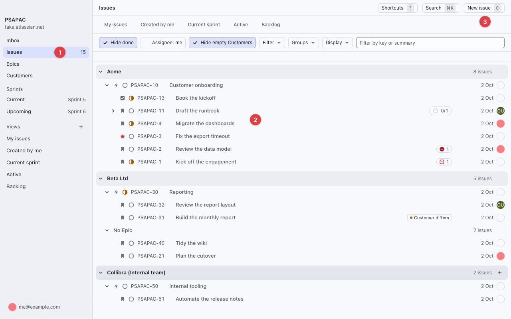

# Jira Task Manager

[](https://github.com/shanedolley/jira-mgr/releases/latest)
-lightgrey)


Jira at the speed of a keyboard. Jira Task Manager is a fast, Linear-style desktop app for macOS that shows your issues as one tree grouped by Customer and Epic, and lets you open, edit, bulk edit and time them without leaving the keys. Its companion command line, `jm`, gives people and AI agents the same operations with JSON output. Both share one TypeScript core and talk straight to Jira: no server, no sync service and no local copy of your data.



## Highlights

**Find your way fast**

- An issue tree grouped by Customer and Epic, with sub-issues, progress and Hide done.
- Saved views, filters, ascending or descending order per view and a Manual order you set by dragging rows.
- A command palette on `Cmd+K` that searches issues and Jira text, and runs any issue action.
- Single-key shortcuts for the common moves. Press `?` to list them all.
- An Inbox, a Sprint page, an Epics table with progress and a Customers page.

**Work without opening anything**

- Change Status, Assignee, Priority, Labels, Sprint, Start date, Due date and the original estimate from the row itself, by click or key.
- Choose which Display columns each row shows, resize them and drag them into your order.
- Peek at an issue beside the list, or open it as a full page with a properties sidebar.
- Check several issues for a bulk edit or a bulk delete, by checkbox, `Cmd+click` or `Shift+click`.

**Write and track**

- A rich description editor that round-trips Jira's format and takes images and file attachments by drag and drop.
- Comments, links, attachments and worklogs on the issue page.
- A timer that logs a worklog from the elapsed time (`T`), and a Log work dialog (`Shift+T`).
- Light and dark themes.

**Built for agents too**

- `jm` covers issues, comments, worklogs, links, attachments, sprints, saved views and the timer.
- It prints a table on a terminal and one JSON value when piped or given `--json`, with fixed exit codes and error codes.
- `jm help --json` describes every command to an agent.

## Install the App

You need an Apple silicon Mac on macOS 13 or later.

1. Open the [latest release](https://github.com/shanedolley/jira-mgr/releases/latest) and download `jira-task-manager-<version>-arm64.zip`.
2. Unzip it and drag `Jira Task Manager.app` into Applications.
3. Open it. The release is signed and notarised, so macOS opens it with no warning.

On first launch the login screen asks for four things:

- Your Jira site address.
- The project key to work in.
- Your Atlassian account email.
- An [Atlassian API token](https://id.atlassian.com/manage-profile/security/api-tokens). The login screen links to the page that creates one.

The app keeps the token in its own macOS Keychain item. It never updates itself: install a newer release over the old one to upgrade. The [install guide](docs/how-to/install-desktop-app.md) covers upgrades, where your data lives and uninstalling.

## Install the CLI

The CLI builds from source and needs Node 24 and pnpm 10:

```
pnpm install --frozen-lockfile
pnpm build
cd apps/cli && npm link
jm auth login
```

The app and the CLI share one login. See [Install the CLI](docs/how-to/install-cli.md) and the [CLI reference](docs/reference/cli.md).

## Jira Requirements

The app works on one Jira project at a time. It was built around a project that tracks work by customer, and it finds these custom fields by name at login:

- Customer
- Engagement
- Sprint
- Start date

Each name must appear once on the project's create screens. Login fails with a message that names the field when one is missing or ambiguous, and a settings file override is the way past it ([ADR-0004](docs/adr/0004-custom-fields-resolved-by-name.md)). Without Customer and Engagement the grouped tree has little to show, so the full experience needs a project that uses them.

## Build From Source

You need Node 24 and pnpm 10.

```
pnpm install
pnpm dev       # run the desktop app in development
pnpm build     # build every package and app
pnpm test      # run the unit tests against a fake Jira
pnpm package   # build Jira Task Manager.app, signed ad hoc
```

[AGENTS.md](AGENTS.md) lists every script.

## Documentation

- [Documentation index](docs/README.md)
- [Using the desktop app](docs/tutorials/using-the-app.md), a tour with screenshots
- [Shortcuts](docs/reference/shortcuts.md)
- [Changelog](CHANGELOG.md) and [roadmap](docs/product/roadmap.md)
- [Architecture](ARCHITECTURE.md) and [domain terms](CONTEXT.md)
- [Contributing](CONTRIBUTING.md) and [AGENTS.md](AGENTS.md) for agent contributors
- [Security](SECURITY.md)

## Licence

Proprietary. Copyright 2026 Shane Dolley. All rights reserved. See [LICENSE](LICENSE).
