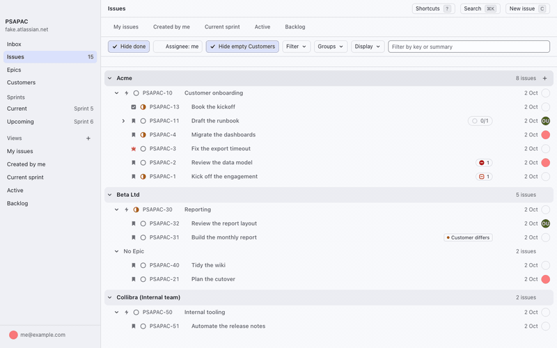
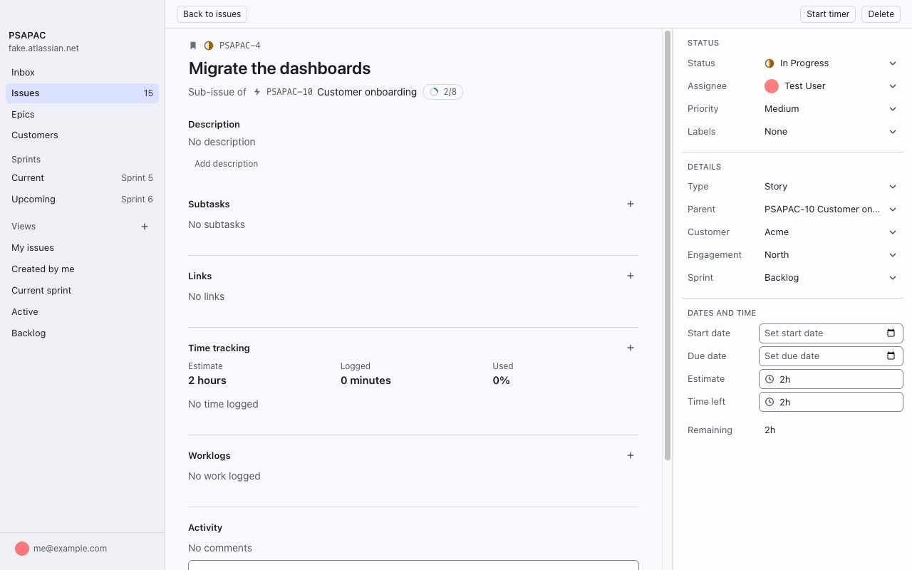
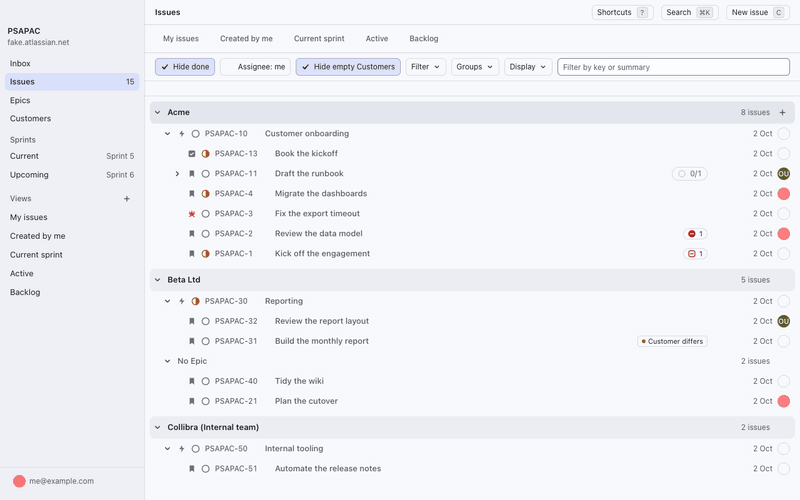

# Using the App

Screenshots show sample data.

## Overview

1. Sidebar: Inbox, Issues, Sprints and saved views.
2. Tree: your issues, grouped by Customer and Epic. Hover a row to make it the active row.
3. New issue: also `C`.

## Create an Issue

1. Click **New issue**, or hover an Epic and press `C` to create under it.
2. Type a summary and pick an Engagement.
3. Click **Create issue**.

## Edit in the Tree

Click a status dot or an avatar on a row, then choose a value. Hover a row and press `S` for Status, `A` for Assignee or `P` for Priority.

## Edit in the Peek

Click a property in the Peek or on the issue page and choose a value. The change saves at once.

## Open an Issue

1. Hover a row and press `o`, or click the issue key, to open the Peek.
2. Click **Open**, or press `Shift+O` from the Tree, to open the issue page.
3. Press `Esc` to return.

## Log Time

Hover a row and press `Shift+T`. Type the time, such as `1h 30m`, and press `Enter`. Press `W` to read the issue's worklogs, newest first.

## Start a Timer

Hover a row and press `T`. Press `T` again, or click **Stop** in the sidebar, then click **Log** to save the time.

## Keyboard

| Key | Action |
|---|---|
| `C` | Create an issue |
| `o` | Open the Peek |
| `Shift+O` | Open the issue page |
| `Esc` | Close the page or the Peek |
| `S`, `A`, `P` | Change Status, Assignee, Priority |
| `Shift+T` | Log work |
| `W` | List the issue's worklogs |
| `T` | Start or stop the timer |
| `?` | List every shortcut |

The rest are in the [shortcut reference](../reference/shortcuts.md).
